# AI Smart Sales Analytics

A web platform that turns a small business's raw sales export into a clear dashboard, a revenue forecast and an AI assistant that answers questions about the data in plain language.

Upload a CSV or Excel file, confirm how its columns map to the standard fields, and the platform cleans the data, calculates the key business metrics and forecasts next month's revenue.


> 🎬 [Full-quality walkthrough video (MP4)](docs/media/demo-walkthrough.mp4)

---

## Features

**Smart data upload and column mapping**
Every store exports sales data differently. The platform reads any CSV or Excel export, recognises common column names automatically (for example `Invoice No.` → Order ID, `Units Sold` → Quantity) and lets the user fix anything it couldn't match before the data is saved.

**Automatic data cleaning**
Duplicate rows are removed, rows missing required fields are dropped, blank optional values are filled in, and the user sees a clear summary of exactly what happened to their data.

**Business dashboard**
Total revenue, units sold, number of orders, average order value and month-on-month growth, with daily / weekly / monthly views, date-range and product filters, a performance-over-time chart and top / lowest-selling products.

**Revenue forecasting**
Next month's revenue is predicted by a LightGBM model trained on daily sales history with holiday and calendar features, with an optional Azure ML AutoML endpoint.

**AI assistant**
A chat assistant powered by Azure OpenAI (GPT-4o) that answers questions such as *"Which products earned the most?"* or *"What's the forecast for next month?"*, grounded in the user's own uploaded data.

**Anomaly detection and reports**
Rule-based anomaly detection at store and product level, plus downloadable reports generated from the dashboard.

**Secure multi-user accounts**
JWT authentication with rotating refresh tokens; every user's files are stored in their own isolated folder in Azure Blob Storage.

## Screenshots

| | |
|---|---|
| 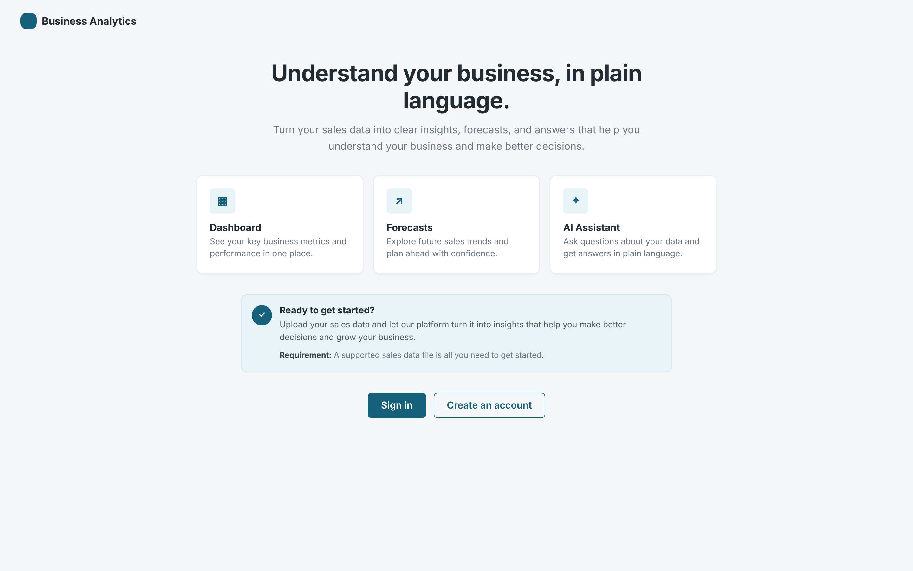 **Landing page** | 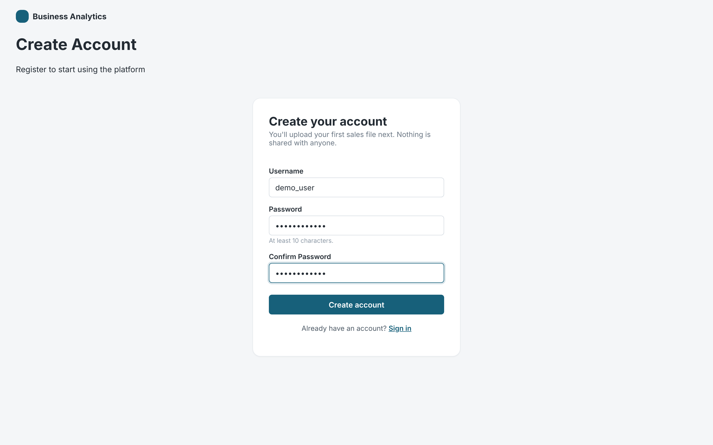 **Sign up** |
| 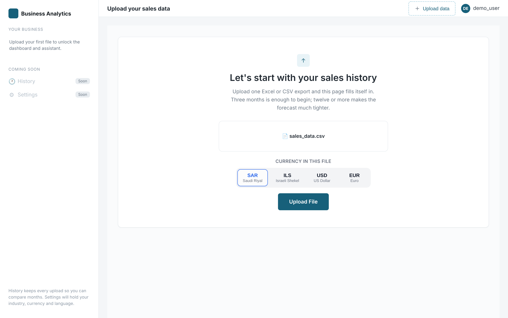 **Upload a sales file and choose its currency** | 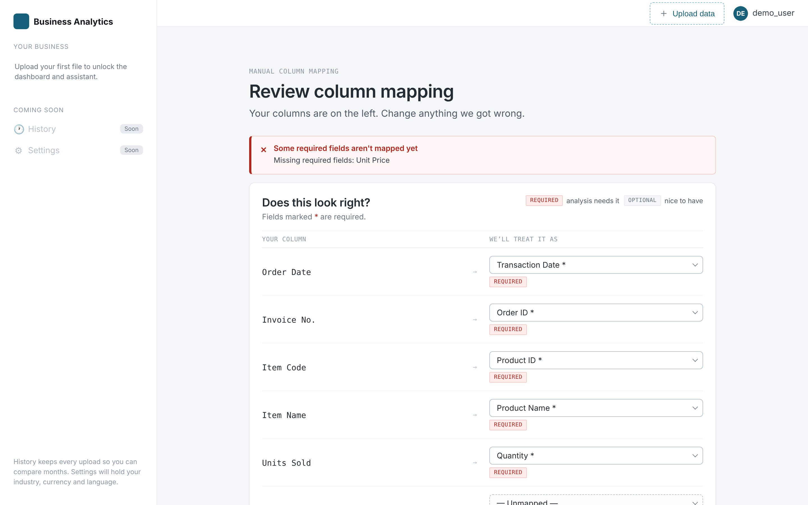 **Review the suggested column mapping** |
| 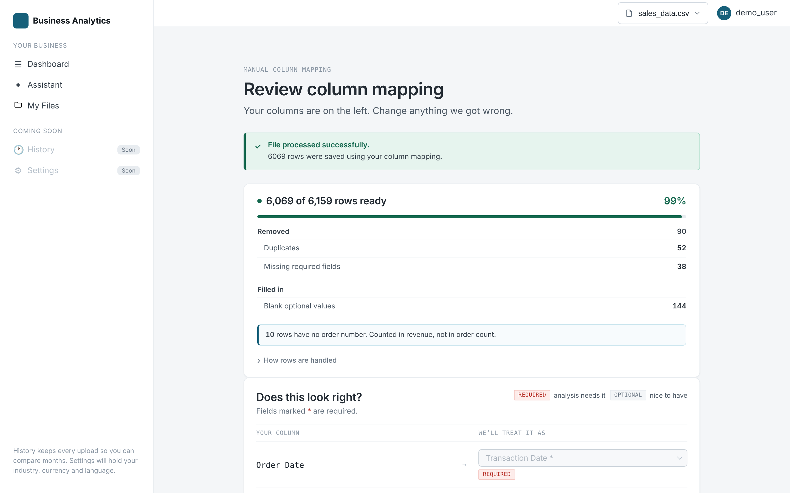 **Data cleaning summary** | 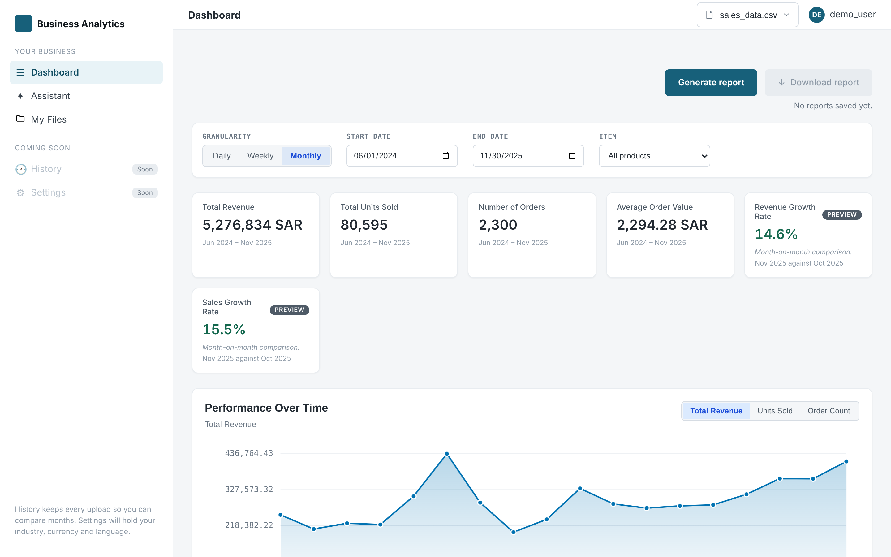 **Dashboard KPIs and filters** |
| 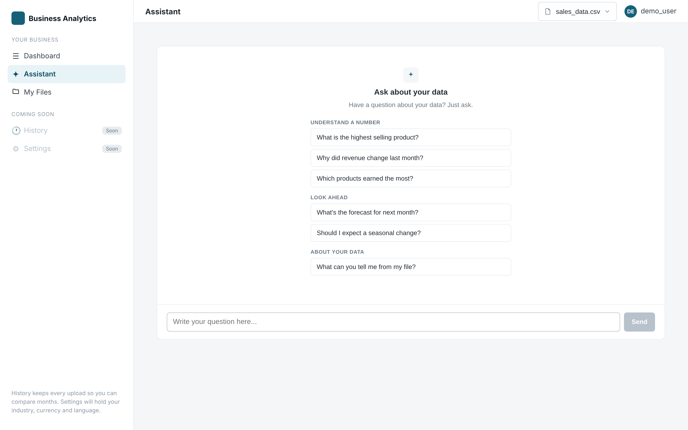 **AI assistant** | 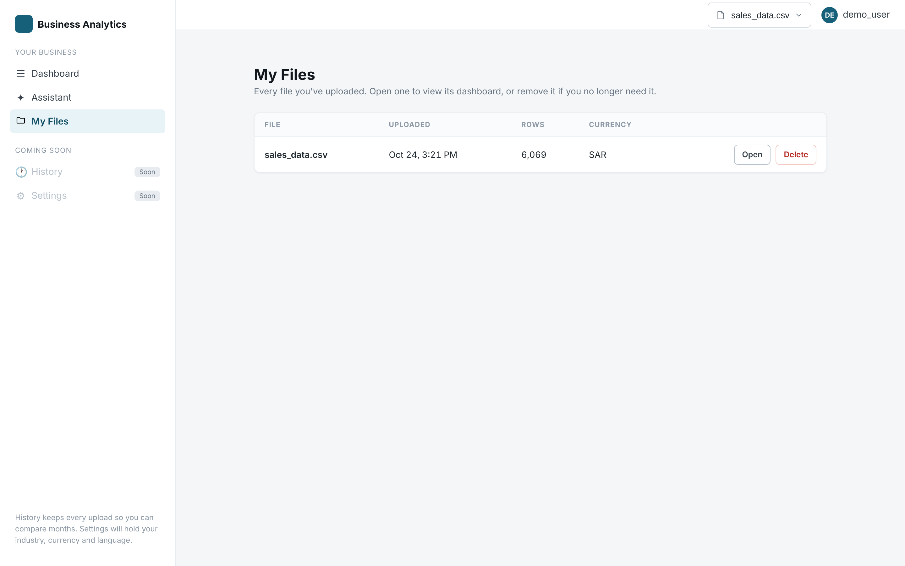 **My Files** |

**Performance over time**
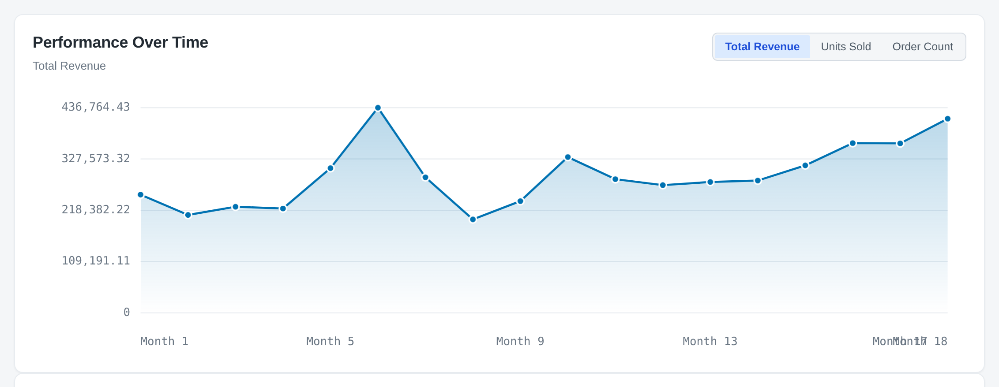

**Top and lowest-selling products**
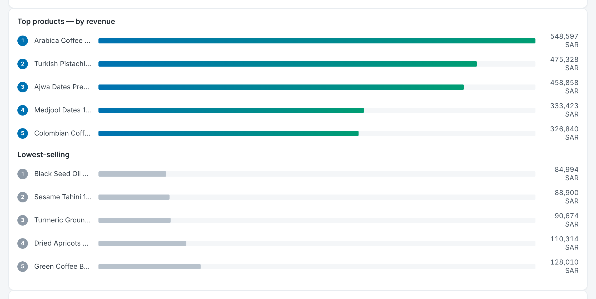

**Revenue forecast**
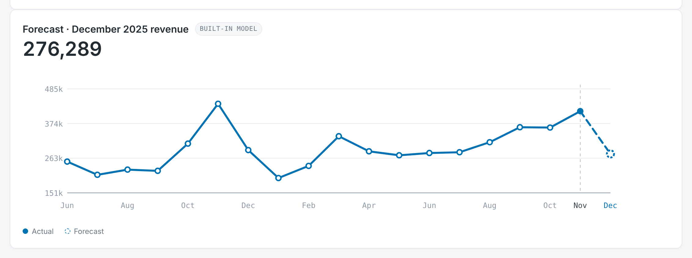

*Screenshots use a synthetic demo dataset of ~6,000 transactions for a specialty food store.*

## Tech stack

| Layer | Technologies |
|---|---|
| Frontend | React 18, Vite, React Router, Recharts, Vitest |
| Backend | Python 3.12, FastAPI, pandas, Pydantic |
| Machine learning | LightGBM, scikit-learn, Azure ML AutoML |
| AI | Azure OpenAI (GPT-4o), Azure Key Vault |
| Data and storage | PostgreSQL (Azure Database for PostgreSQL), Azure Blob Storage |
| Auth | JWT access tokens and rotating refresh-token cookies, bcrypt |
| DevOps | Azure App Service, Azure DevOps pipelines, Ruff, ESLint, Prettier, Husky |

## Project structure

```
backend/
  app/
    auth/               JWT auth, refresh tokens
    data_pipeline/      parsing, column mapping, validation, cleaning
    forecast/           forecasting models and API
    anomaly/ services/  store and product anomaly detection
    chatbot/            AI assistant (Azure OpenAI with data grounding)
    recommendations/    recommendation contract and provider
    storage/            Azure Blob and local storage backends
  models/               trained forecasting model
frontend/
  src/features/         auth, upload, dashboard, forecast, chatbot, files, reports
docs/                   design notes, data contracts, model research
tests/                  backend and mapping tests
```

## Running locally

**Backend** (Python 3.12):

```bash
cd backend
python -m venv .venv
source .venv/bin/activate   # Windows: .venv\Scripts\activate
pip install -r requirements.txt
cp .env.example .env         # then fill in the values
python -m app.main           # http://127.0.0.1:8000
```

**Frontend** (Node 22):

```bash
cd frontend
npm install
npm run dev                  # http://localhost:5173
```

The backend needs a PostgreSQL database and, for file storage and the AI assistant, Azure Blob Storage and Azure OpenAI credentials. See [docs/DEPLOYMENT.md](docs/DEPLOYMENT.md) for the full configuration and Azure deployment guide.

**Tests:**

```bash
python -m pytest tests backend/tests
cd frontend && npm test
```

